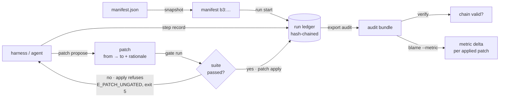
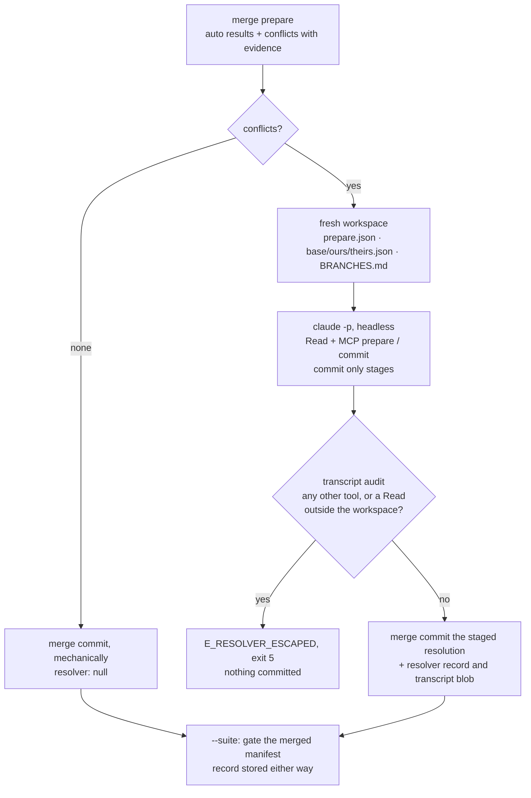

# agentvcs

<p align="center">
  
</p>

[](https://github.com/EvolvingAgentsLabs/agentvcs/actions/workflows/ci.yml)


[](LICENSE)

**Version control for agent harnesses that change while they run.**

> Every step of a run is stamped with the exact harness version that produced it — prompts, models,
> sampling, tools, adapters, router. A patch is **gated** before it applies, `blame` attributes a change in a
> metric to the patch that brought it, and two harnesses that diverged are **merged** dimension by
> dimension: each real conflict goes to **Claude Code — agentvcs's only LLM** — with the evidence behind
> both sides, and agentvcs checks the resolution before recording it. Rust core, CLI, MCP server, Python SDK.

**Why it matters.** Agent harnesses no longer hold still while they run: a prompt is edited, a model or an
adapter swapped, a tool added — mid-run, and often by more than one person or agent. When a result moves, a
team then needs to know which change moved it; when two copies of a harness diverge, it needs to merge them on
the evidence behind each side, not on whoever wrote last. If that holds, a harness change becomes something a
team can review and attribute like a code change, and a merge of two improvements keeps both where the
evidence supports both. Built: stamping, gating, `blame`, `bisect` and dimension-by-dimension merge, under 117/117
conformance cases and one real-model run (gate F2, below). Not yet: a real Claude Code resolution session in
any test or recorded run, and any team running it on its own harness.

## Status — 2026-10-08

[ran] = observed by executing it; [read] = from this repo's files.

**Works [ran]**
- Protocol conformance: **117/117** against a release build of the Rust CLI (hash 15, manifest 13, diff 16,
  verify 31, blame 8, bisect 14, merge 20) [ran, 2026-10-14; `conformance/results/rust-2026-10-14.md`]. The `Rust`, `Python SDK` and `CI` workflows are green on `main`.
- Rust core, CLI and MCP server: `snapshot`, `run`, `step record`, `patch propose/apply`, `gate run`,
  `export audit`, `verify`, `blame`, `bisect`, `diff`, `merge prepare/commit/resolve` — covered by the conformance cases and CI.
- `merge resolve` (spec/MERGE.md §6): isolated `claude -p` with `Read` + two MCP tools, transcript audit
  (`E_RESOLVER_ESCAPED`), `resolver` recorded — tested end to end in CI with a **fake** `claude`.
- Gate F2 on a real model: `examples/toy_pipeline`, Qwen2.5-1.5B on llama.cpp, 2700 docs — paired gate gain
  **+0.444**, blame **+0.442** attributed to exactly the one patch applied mid-run, `verify` clean
  ([RUN_REAL.md](https://github.com/EvolvingAgentsLabs/agentvcs/blob/main/examples/toy_pipeline/RUN_REAL.md)) [ran, 2026-10-06].
- `bisect` with a real probe: on a toy run where a regression landed back to back with a harmless patch,
  `blame` can only credit the pair (−0.333); `bisect` re-executes each candidate from the run's checkpoint on the
  same documents and names the regression in 4 probes; the control run has nothing to find
  (`examples/toy_pipeline/regression.py`, fake backend, in CI) [ran, 2026-10-14].
- `examples/lora-kernel` (LK0): import → nine imported, gated patches → conflicting branches → `merge resolve`;
  tests and `demo.sh --dry-run` run in CI on a fixture (fake `claude`).
- Legacy pure-Python package: 220 tests pass [ran, 2026-10-08].

**Measured, does not hold (yet)**
- `step record` through the CLI: p99 5.7–7.8 ms against a 2 ms target; the in-process library/SDK path meets it
  ([BENCHMARKS.md](https://github.com/EvolvingAgentsLabs/agentvcs/blob/main/docs/BENCHMARKS.md)) [ran, 2026-10-06].
- Gate F2's first real-model run, with an absolute gate (`recall ≥ 0.9` on 12 docs), failed at 0.889; the paired
  gate that passed was adopted *after* that result, logged as a change of instrument [read, RUN_REAL.md].
- The `--no-reload` control arm has run only on the fake backend (delta 0), not on the real model [read].

**Not implemented**
- PyPI: `pip install agentvcs` does not exist (pypi.org returns 404) [ran]; build the SDK from source.
- A real Claude Code `merge resolve` session is not exercised by any test or recorded run in this repo [read].
- A `blob put` CLI verb; remotes/sync; async SDK API; the move of
  the Python implementation to `legacy/` ([LATER.md](https://github.com/EvolvingAgentsLabs/agentvcs/blob/main/LATER.md)) [read].
- Merge v0.2 leaves out ledger/run merges, octopus merges and field-level auto-merge (spec/MERGE.md §7) [read].

**Next** — this repo commits to no dated step. Pending per README and ADR-0007 §2: move the Python package to
`legacy/` and publish the SDK wheel. Everything in LATER.md stays unplanned until it moves into the plan.

## Part of EvolvingAgentsLabs

agentvcs is one of three active projects of [EvolvingAgentsLabs](https://evolvingagentslabs.github.io); how they
connect is drawn on the [website](https://evolvingagentslabs.github.io/#connections).

- **[lora-kernel](https://github.com/EvolvingAgentsLabs/lora-kernel)** serves small local models as trained
  specialists, with a router that abstains to a frontier model. **Built:**
  [`examples/lora-kernel`](https://github.com/EvolvingAgentsLabs/agentvcs/tree/main/examples/lora-kernel) (LK0)
  imports its serving configuration as a harness manifest and its measured changes as gated patches, then merges two
  conflicting branches through `merge resolve`. Imported, not live: nothing is re-run, the branches are constructed
  for the demo, and lora-kernel's models are the controlled system, never part of agentvcs.
- **[gene-evidence](https://github.com/EvolvingAgentsLabs/gene-evidence)** writes auditable evidence reports for
  gene predictions, every sentence citing a node of a versioned evidence graph; no model in its stage 1. **Next, not
  built:** each evidence run versioned as an agentvcs run, so a database release or a rule change is a patch and
  `blame` traces a change in the report to it. Today it records its versions in its own files.

## Rust core (v0.1, in progress)

The revival rebuilds agentvcs around a frozen protocol ([`spec/`](https://github.com/EvolvingAgentsLabs/agentvcs/blob/main/spec/PROTOCOL.md))
as a Rust core, CLI and MCP server (ADR-0001). The Python implementation documented
below stays the released one until the plan moves it to `legacy/`.

How a run is versioned, end to end — every arrow is one CLI verb (the same over MCP and the SDK):



```bash
cargo build --release                       # target/release/agentvcs
python3 conformance/run.py --cli "$PWD/target/release/agentvcs"   # 117/117
cargo test --workspace
```

```bash
agentvcs init --json
agentvcs snapshot manifest.json --json                  # -> manifest_id
agentvcs run start --manifest b3:… --run-id r1 --json
echo '{"agent_id":"x","inputs":[],"outputs":[],"started_at":"…","ended_at":"…",
       "tokens":{"in":1,"out":1},"latency_ms":3,"metrics":{"f1":0.4}}' \
  | agentvcs step record r1 --json
agentvcs patch propose r1 --from b3:… --to v2.json --rationale "…" --json
agentvcs gate run b3:<patch> --suite suite.yaml --json  # suite: command + thresholds
agentvcs patch apply b3:<patch> --json                  # refuses ungated patches (exit 5)
agentvcs export audit r1 -o r1.audit.json --json
agentvcs verify r1.audit.json --json && agentvcs blame r1.audit.json --metric f1 --json
agentvcs mcp                                            # the same commands as MCP tools
```

Crates: `agentvcs-core` (canonical JSON, BLAKE3, manifests, store, ledgers),
`agentvcs-diff`, `agentvcs-query` (verify, blame, bisect), `agentvcs-merge`, `agentvcs-cli`,
`agentvcs-mcp`, `agentvcs-py` (the Python SDK, below). Implementation decisions:
[ADR-0006](https://github.com/EvolvingAgentsLabs/agentvcs/blob/main/docs/adr/0006-f1-implementation-notes.md). Numbers:
[docs/BENCHMARKS.md](https://github.com/EvolvingAgentsLabs/agentvcs/blob/main/docs/BENCHMARKS.md).

### Merge (v0.2 draft)

Two lines of a harness that diverged from a common manifest merge three-way,
dimension by dimension ([spec/MERGE.md](https://github.com/EvolvingAgentsLabs/agentvcs/blob/main/spec/MERGE.md)).
agentvcs merges what is mechanical and hands each real conflict to an agent with
the evidence a run observed — the patches that touched that dimension, their
gates and their blame deltas. The agent writes a resolution; agentvcs checks it,
stores the merged manifest (`parent_ids: [ours, theirs]`) and a merge record,
and gates it. It never decides a conflict by itself.

```bash
agentvcs merge prepare --base b3:… --ours b3:… --theirs theirs.json \
    --ours-run r1 --metric f1 --json            # auto results + conflicts with evidence
# the agent writes resolution.json: per conflict {"take": "ours"|"theirs"|"base"|"delete"}
# or {"kind", "content"}, plus a rationale (spec/MERGE.md §3)
agentvcs merge commit --base b3:… --ours b3:… --theirs theirs.json \
    --resolution resolution.json --suite suite.yaml --json   # exit 1 if the gate fails
agentvcs patch propose r1 --from b3:<ours> --to b3:<merged> --rationale "merge:b3:<record>" --json
```

Applying a merge to a running system is an ordinary gated patch, so `blame`
attributes what the merge changed. Same commands over MCP (`merge_prepare`,
`merge_commit`) and in the SDK (`avcs.merge_prepare`, `avcs.merge_commit`).
Decisions: [ADR-0008](https://github.com/EvolvingAgentsLabs/agentvcs/blob/main/docs/adr/0008-merge.md).

#### Resolve a merge with Claude Code

agentvcs has no model of its own: when a merge needs judgment, `merge resolve`
hands the conflicts to [Claude Code](https://docs.anthropic.com/en/docs/claude-code)
and keeps every guarantee on its side ([spec/MERGE.md §6](https://github.com/EvolvingAgentsLabs/agentvcs/blob/main/spec/MERGE.md#6-resolving-with-claude-code--merge-resolve)).

```bash
agentvcs merge resolve --base b3:… --ours b3:… --theirs theirs.json \
    --ours-run r1 --metric f1 --suite suite.yaml \
    --model claude-opus-5-5 --budget-usd 1 --max-turns 20 --json
agentvcs merge resolve … --dry-run --json      # write the workspace, print the claude command
```

No conflicts: it commits mechanically and never starts the agent. Otherwise
Claude Code runs headless in a fresh temporary workspace that holds only
`prepare.json`, the three manifests and `BRANCHES.md`, with `Read` and two MCP
tools bound to this merge (`agentvcs mcp --merge-session <dir>`: `prepare`, and
`commit`, which validates and *stages* the resolution). After the session agentvcs
audits the transcript — any other tool, or a `Read` outside the workspace, even a
denied one, is `E_RESOLVER_ESCAPED` (exit 5) and nothing is committed — then
commits the staged resolution exactly as `merge commit` does and adds a `resolver`
object to the merge record (Claude Code version, model, cost, turns, and the
transcript as a blob). Over MCP it is the `merge_resolve` tool; in the SDK,
`avcs.merge_resolve(...)`. Inside an interactive Claude Code session, the
[`agentvcs-merge` skill](https://github.com/EvolvingAgentsLabs/agentvcs/blob/main/.claude/skills/agentvcs-merge/SKILL.md)
covers both ways to ask for a merge.



<p align="center">
  
</p>

*LK0 on its CI fixture, `--dry-run`: the conflicts arrive with their evidence; Claude Code is not invoked.*

### Python SDK (v0.1, Phase 2)

`crates/agentvcs-py` is the Python package `agentvcs` — a thin PyO3 binding over
the Rust core plus harness ergonomics ([ADR-0007](https://github.com/EvolvingAgentsLabs/agentvcs/blob/main/docs/adr/0007-python-sdk-layout.md)).
Not on PyPI yet; build it locally:

```bash
crates/agentvcs-py/dev.sh test        # venv + maturin develop --release + pytest
```

```python
import agentvcs as avcs

with avcs.run("manifest.json", store=".") as run:          # run_start ... run_end(status)
    run.on_patch(lambda ev: print("reload", ev.changed_dimensions))
    run.checkpoint(lambda step: save_kv_state(step.step_index))   # -> checkpoint_ref

    @avcs.step(agent_id="extractor")                     # one StepRecord per call
    def extract(doc):
        prompt = run.manifest["extract.prompt"]["template"]   # always the active manifest
        avcs.current_step().metric("f1", score(...))
        ...
```

`python -m agentvcs` (and the `agentvcs` console script of the wheel) is the Rust
CLI in-process; it passes the same 117/117 conformance cases. Model wrappers for
OpenAI-compatible servers (llama.cpp, vLLM, Ollama) and Claude live in
`agentvcs.integrations`; the end-to-end example is
[`examples/toy_pipeline`](https://github.com/EvolvingAgentsLabs/agentvcs/blob/main/examples/toy_pipeline/README.md).

**Name clash.** The legacy pure-Python package documented below also imports as
`agentvcs`. Use one per virtualenv: the root `pyproject.toml` is the legacy one,
`crates/agentvcs-py/pyproject.toml` the SDK.

**Apple Silicon with an x86_64 rustup (Rosetta).** If `rustc -vV` says
`host: x86_64-apple-darwin` but your Python is arm64, a plain build links the
extension for the wrong architecture (`symbol(s) not found for architecture
x86_64`). `dev.sh` detects this and builds with `--target aarch64-apple-darwin`
(`rustup target add aarch64-apple-darwin`). The permanent fix is a native
toolchain: reinstall rustup from an arm64 shell, or
`rustup toolchain install stable-aarch64-apple-darwin && rustup default
stable-aarch64-apple-darwin`. `cargo build` at the root skips the binding
(it is not a default workspace member); `cargo clippy/test --workspace` still
cover it.

## Legacy: the pure-Python implementation

> **Every section from here to *Scope* documents the pure-Python package (2026-06/07)**, which stays the released
> one until it moves to `legacy/` (see Status). Its model — one commit carrying code, goal, models, trace and
> swarm; `freeze` into a crystal; `merge --reconcile` — predates the Rust protocol above and is not what
> `spec/` specifies. Its 220 tests pass; its numbers are its own.

## The problem: your agent evolves, git never sees it

An autonomous agent doesn't just *run* your system. In the field it **rewrites** it — a new
skill, an edited tool, a spawned sub-agent, a redirected goal, a prompt tuned against
production experience. Git tracks static text, so none of that exists as far as your
repository is concerned.

Then the team ships the next release, and it **overwrites every field-learned adaptation and
the reasoning behind it.** The agent starts over.

**agentvcs's goal is to make that run-time evolution first-class and trustworthy:**

1. **Capture** every iteration as one commit across code + goal + models + trace + swarm.
2. **Prove & freeze** what works into a deterministic, replayable recipe.
3. **Reconcile** the agent's run-time line back into your git releases instead of losing it.
4. **Measure** whether the self-modification is actually improving — not just changing.

It **complements** git — it doesn't replace it ([how it compares](https://github.com/EvolvingAgentsLabs/agentvcs/blob/main/docs/COMPARISON.md)). Git
stays the system of record for what your team designs; agentvcs is the persistent episodic
memory of what the agent became at run-time.

```
 design-time line   ●──────●──────●   what your team develops & releases under git
                     \              \
                      \              ▼  agentvcs merge --reconcile <agent>
                       \            ◆  one reconciled history
                        \          ▲
 run-time line          ●────●────●   what the autonomous system changed about itself
```

## One commit: four dimensions plus a state

A commit here is not a text diff. It is an atomic snapshot of four simultaneous dimensions —
and, when the agent has them, a sub-agent **swarm** and the runtime **frame**:

| Dimension | What it holds |
|---|---|
| **code** | the files as usual — tools, scripts, markdown skills |
| **goal** | the intent or directive the agent was pursuing |
| **models** | which LLM ran, with which params (temperature, …) |
| **trace** | the chain of thought, tool calls and real results that *caused* the change |

```
            ┌─────────── one commit ───────────┐
   code  →  │  tree     goal     models   trace │   state: fluid | crystallized
            └───────────────────────────────────┘
```

And every commit carries a **state**:

- **`fluid`** — the agent is still iterating, searching probabilistically: high-temperature
  models, code/skills/prompts/goals mutating between iterations. Powerful, expensive,
  non-deterministic. This is where new problems get solved.
- **`crystallized`** — a solution you trust, *frozen*. Once the agent passes its evaluation
  (`agentvcs eval`), `agentvcs freeze` pins the models to temperature 0 and compiles the
  iteration into a replayable **recipe**: cheap, stable, deterministic.

`agentvcs diff` tells you *which dimension* moved — a goal redirect and a code change are
distinguishable events, not one opaque text diff:

```
705b2fb..1d4bd90
  code
    ~ app.py
  goal
    from: Resolve refund requests autonomously
    to:   Resolve refund requests with fraud checks
```

## What it does that a code VCS can't

### Semantic merge — `merge --reconcile`

The flagship feature. When the design-time line (your team's codebase) and the run-time line
(what the agent learned in production) diverge, a plain `git merge` clobbers the field
adaptations or buries them in conflict markers — and it has no idea what the *goal* or the
*reasoning* should become.

agentvcs merges each dimension appropriately: three-way merge for code/skills (the
eval-winner auto-resolves conflicting hunks first), union for model pins, node-by-node for
the swarm — then hands the **semantic** decision to an agent you trust. It writes
`{base, ours, theirs}` goals, traces, code diffs and eval/cost metrics to a subprocess's
stdin and reads back `{goal, trace, notes, resolved_files}`:

```bash
agentvcs merge runtime/main --reconcile "nanoloop reconcile"
```

That is the whole interface. The core has no LLM dependency and no opinion about what sits on
the other end — the reconciler synthesizes unified knowledge and can even return the
conflict-free files agentvcs then writes.

### Multidimensional rollback — the panic button

When an iteration goes wrong, `agentvcs rollback` restores not just the code but the exact
prior goal, model pins and memory, and records *why* in a durable ledger:

```bash
agentvcs rollback --reason "v3 collapsed routing; urgency flag regressed"
```

It is itself reversible.

### Evolutionary diagnostics — is the self-modification working?

AI-generated code suffers regressions a code review won't see. Because agentvcs owns the
whole *recorded lineage* — a population of variants over time, each with an eval score — it
can measure things a code VCS can't. These are exact, standard-library computations over the
commit graph, with **no extra LLM calls**:

| Diagnostic | Model | Question it answers |
| --- | --- | --- |
| `price` | **Price equation** `w̄·Δz̄ = Cov(w,z) + E[w·Δz]` | Is improvement from *selecting* between branches, or *editing* within a lineage? |
| `price` (threshold) | **Eigen error catastrophe** (`μL < ln σ`) | Is self-editing losing information faster than selection recovers it? |
| `health` | **Critical slowing down** (lag-1 autocorrelation + variance) | Is a collapse coming *before* the mean score moves? |
| `health` / `branch` | **Muller's ratchet** | Is an unmerged branch a decaying asexual lineage that needs recombination (`merge`)? |
| `infobits` | **Kelly / Kussell–Leibler & channel capacity** (`I(context; action)` in bits) | How much can more context retrieval actually buy — where's the compression headroom? |
| `contain` | **Branching process** `R₀ = n·p` | Will one poisoned entry in shared memory spread across the swarm, or die out? What verification rate contains it? |

The honest scope: these measure a population of variants across time — the object a **version
control system** owns. Controller/fleet math (throughput control, sampling, scheduling)
belongs to a live harness and is deliberately *out of scope*. Full derivations, mappings and
the scope boundary: [`docs/EVOLUTIONARY_DYNAMICS.md`](https://github.com/EvolvingAgentsLabs/agentvcs/blob/main/docs/EVOLUTIONARY_DYNAMICS.md).

## Real demos

Runnable, narrated, and on the web — every number comes from a real `agentvcs eval`, nothing
faked. **[Live demos ↗](https://evolvingagentslabs.github.io/agentvcs/demos/)** ·
reproduction guide [`docs/DEMOS.md`](https://github.com/EvolvingAgentsLabs/agentvcs/blob/main/docs/DEMOS.md).

- **Business cases — plain English, no math on screen**
  (`bash examples/business-cases/run.sh`). Five everyday situations, each ending in a
  one-line call: a support bot that quietly gets worse every week (*roll back*), a client
  fork nobody merged (*merge it before it rots*), a prompt stuffed with context that changes
  nothing (*trim it, save cost*), one bad fact poisoning a shared-memory fleet (*verify N% of
  reads*).
- **Evolution diagnostics — the technical companion**
  (`bash examples/evolution-diagnostics/run.sh`). The same five with the real numbers and
  the theory; every claim asserted against `--json`.
- **Self-evolving eve merge** (`bash examples/eve-evolve-merge/demo.sh`). A
  [Vercel **eve**](https://vercel.com/eve) agent rewrites its own skill and spawns a
  sub-agent at run-time while the team evolves the same files in git — and `merge` fuses
  both. Offline, no API key.
- **The full agent loop** (`bash examples/agent-loop-demo/run.sh`). A simulated autonomous
  agent driving commit → eval → **rollback (with a recorded reason)** → freeze end to end.

More in [`examples/README.md`](https://github.com/EvolvingAgentsLabs/agentvcs/blob/main/examples/README.md).

## Architecture & ecosystem

**Zero dependencies.** Everything is built on the Python standard library alone — deliberate,
for maximum auditability and drop-in integration. The data model underneath is a git-style
content-addressed object store with typed objects (`commit` / `tree` / `goal` / `modelpin` /
`trace` / `crystal`), a per-commit `fluid ↔ crystallized` state machine, and a three-way
*semantic* merge over the merge-base ([`docs/SPEC.md`](https://github.com/EvolvingAgentsLabs/agentvcs/blob/main/docs/SPEC.md)). Model pins are
provider-agnostic (Anthropic, Google, Qwen, …); `"auto"` fills the pin from the model that
actually ran, so it can't drift.

**Passive trace capture (providers).** You don't instrument your code to record traces.
agentvcs reads what the runtime already writes — local session files or events — through
built-in providers: `claude-code`, `qwen-code`, `anthropic-managed`, `vercel-eve` and
`odyssey`. Declare one in `agent.json` and commits capture reasoning automatically. Secrets
are `[REDACTED]` by default.

**Built for agents.** Every command accepts `--json` and emits a single parseable object with
stable `error.code`s, so an agent recovers programmatically instead of parsing English. An
**MCP server** ships too — `claude mcp add agentvcs -- agentvcs-mcp` (zero-dependency, stdio
JSON-RPC) — exposing the same capabilities to Claude, Cursor or any MCP client so the agent
can version itself autonomously. `agentvcs new` scaffolds an `AGENTS.md` so the next agent
learns the workflow.

**Optional Web3 identity — Souls of Silicon.** Off by default, zero crypto surface otherwise.
`agentvcs init --with-soul` gives each instance an **Ed25519 Soul**, signing every commit
(forge-proof provenance). Every verified `freeze` mints a **Soulbound Token**, building a
verifiable CV of what the agent has actually proven — reputation that can't be cloned. Fleets
are selected with DeSoc correlation discounting for maximum diversity. Full vision:
[`docs/papers/souls-of-silicon.md`](https://github.com/EvolvingAgentsLabs/agentvcs/blob/main/docs/papers/souls-of-silicon.md). A separate opt-in
**corporate/legal layer** (`agentvcs init --corporate`) adds an audit log and signed human
approvals for governed deployments.

## Install

Not on PyPI yet — publishing waits for the v0.1 protocol.

Zero runtime dependencies — standard library only, with
[a test](https://github.com/EvolvingAgentsLabs/agentvcs/blob/main/tests/test_zero_dependencies.py)
that walks the AST and fails if that ever stops being true. Nothing is pulled in
behind you.

From source:

```bash
git clone https://github.com/EvolvingAgentsLabs/agentvcs
cd agentvcs && pip install -e .
```

> `avcs` is a built-in shorthand for `agentvcs` — every command works with either name.

## Quickstart

```bash
agentvcs new my-agent          # scaffold a project pre-wired for agents (agent.json, AGENTS.md, CC skill, MCP)
cd my-agent
agentvcs commit -m "initial fluid agent"
agentvcs diff                  # dimensional diff: code vs goal vs models vs trace
agentvcs eval && agentvcs freeze   # prove it, then crystallize (freeze is gated on the eval)
agentvcs price                 # is the self-modification net-positive?
```

Declare the non-code dimensions in `agent.json`:

```json
{
  "goal": "Resolve refund requests autonomously",
  "models": [{ "provider": "anthropic", "model": "claude-opus-4-8", "params": { "temperature": 1.0 } }],
  "trace": { "provider": "claude-code", "auto": true },
  "swarm": { "refund-verifier": { "role": "verify a refund", "skill_file": "agent/subagents/refund-verifier.md" } },
  "eval": { "command": "pytest -q", "runs": 3 },
  "state": "fluid"
}
```

`freeze` refuses to crystallize a commit that hasn't passed its `eval` (`EVAL_FAILED`);
`freeze --force` past a failure marks the recipe `verified: false` — never a silent lie.
"Crystallized" means "proven", enforced in code rather than in the README.

## Commands

| command | what it does |
|---|---|
| `agentvcs new DIR` / `init` | scaffold / create a repository (`--claude-code` / `--qwen-code` / `--eve` wire trace capture) |
| `agentvcs commit -m MSG` | snapshot code + goal + models + trace |
| `agentvcs log` / `status` / `show` / `diff` | history / working-tree changes / one commit / dimensional diff |
| `agentvcs branch` / `checkout REF` | list/create a live branch / restore the working tree |
| `agentvcs merge BRANCH` | multidimensional merge; `--reconcile CMD` hands goal+trace+conflicts to an agent; `--target-goal` directs it |
| `agentvcs rollback [REF] --reason TEXT` | undo: restore the full prior state, with a recorded justification (the panic button) |
| `agentvcs eval` / `freeze` / `replay` / `recall` | the trust gate: prove → crystallize → re-run → find |
| `agentvcs price` / `health` | is the evolution *working*: selection-vs-transmission + error-catastrophe & ratchet warnings |
| `agentvcs infobits` / `contain` | information value of context (bits) · shared-memory poisoning containment (R₀) |
| `agentvcs runtime` / `budget` / `context` / `statusline` / `watch` | the operational frame your runtime hides |
| `agentvcs ui` | serve a local web dashboard to *watch* the evolution |
| `agentvcs soul` / `verify` / `fleet` | optional Soul/DeSoc layer (see above) |

## Learn more

- **Demos** — plain-English business stories + the technical companion:
  [live demos](https://evolvingagentslabs.github.io/agentvcs/demos/) ·
  [`docs/DEMOS.md`](https://github.com/EvolvingAgentsLabs/agentvcs/blob/main/docs/DEMOS.md)
- **The math & models** — derivations, mappings, scope boundary:
  [`docs/EVOLUTIONARY_DYNAMICS.md`](https://github.com/EvolvingAgentsLabs/agentvcs/blob/main/docs/EVOLUTIONARY_DYNAMICS.md)
- **How it compares** — next to git, LangSmith/Langfuse and MLflow/W&B, and what it is *not*:
  [`docs/COMPARISON.md`](https://github.com/EvolvingAgentsLabs/agentvcs/blob/main/docs/COMPARISON.md)
- **Tutorial / Spec / Agent contract** — [`docs/TUTORIAL.md`](https://github.com/EvolvingAgentsLabs/agentvcs/blob/main/docs/TUTORIAL.md) ·
  [`docs/SPEC.md`](https://github.com/EvolvingAgentsLabs/agentvcs/blob/main/docs/SPEC.md) · [`docs/AGENT_MODE.md`](https://github.com/EvolvingAgentsLabs/agentvcs/blob/main/docs/AGENT_MODE.md)

## Scope

agentvcs does not try to replace git. Git stays what your human team builds and releases with
at design time; agentvcs is the agent's **persistent episodic memory** at run-time, closing
the gap between MLOps, LLMOps and ordinary DevOps — purely locally.

This repo is the **local protocol and runtime** — complete on its own, offline, forever. It
**complements** your existing stack (git, LangSmith/Langfuse, MLflow/W&B) rather than
replacing any of it. Hosted collaboration and fleet observability at scale are a separate
concern, not part of this open-source core.

**Before you trust it:** the bundled demo reconciler is a deterministic bullet-union stub —
honest in its docstring, but not intelligent; the LLM reconciler is a separate piece. Test
coverage is lopsided: the optional cryptographic layer has 20 tests while the core object
store has 5. 220 tests pass (legacy Python suite; CI runs it on Python 3.10–3.13).

## License

Apache-2.0. See [LICENSE](https://github.com/EvolvingAgentsLabs/agentvcs/blob/main/LICENSE).
